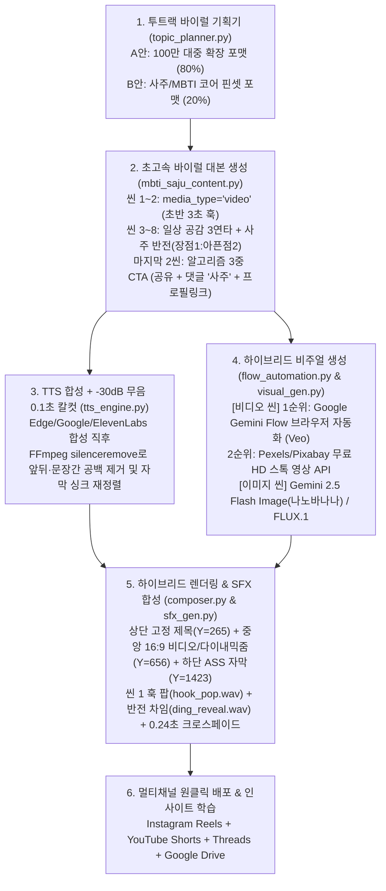

# 🚀 MBTI × 사주(MBTIJU) 100만+ 바이럴 릴스 리부트 마스터 기획안

> **목표**: 기존 최고 성과(1,300+ 뷰)의 한계를 돌파하여 **비팔로워 탐색탭·릴스탭 100만+ 뷰 폭발**과 **mbtiju.com(30초 무료 체험 & 3년 심층 사주 리포트) 전환율 극대화**를 동시에 달성하는 **비용 0원~최소화 하이브리드 영상 자동화 파이프라인**.

---

## 1. 기존 릴스 정밀 진단: 왜 1,300뷰에서 멈추고 100만 뷰를 못 넘었을까?

기존 저장소(`insta_auto`)의 데이터와 코드(`topic_planner.py`, `visual_gen.py`, `tts_engine.py`, `composer.py`, `cta.py`)를 전수 분석한 결과, **4가지 구조적 병목**이 존재했습니다.

| 병목 구간 | 기존 파이프라인의 한계 | 100만 바이럴 리부트 해결책 |
| :--- | :--- | :--- |
| **1. 타겟 모수(TAM)의 천장** | `"을목 여자 특징? 이거 모르면"`처럼 첫 1초부터 명리학 용어(일간 10종)를 전면에 배치 → **본인이 '을목'인지 아는 상위 5%만 반응하고, 일반 대중 95%는 1초 만에 스와이프 이탈** | **투트랙 퍼널(대중 확장 80% + 사주 코어 20%)**: 첫 3초는 **누구나 아는 일상 행동·연애 심리·체크리스트·밸런스 게임·페이크아웃 반전**으로 100% 대중을 멈춰 세운 뒤 → 본문 중반(씬 4~6)에 *"사실 이게 사주에 OO(도화살/홍염살/을목/식신)이 있는 사람들의 소름 돋는 특징인데"*로 반전 해부 |
| **2. 정지 사진 슬라이드쇼 피로감** | 8~10개 전 씬이 정지 사진(`16:9` 이미지) + 느린 줌인(Ken Burns 18%)으로만 구성되어 3초 이후 시각적 도파민 저하 | **하이브리드 비디오 파이프라인**: 초반 1~2씬(첫 3~5초 골든타임)은 **구글 제미나이 Flow (`labs.google/fx/ko/tools/flow`) 브라우저 자동화** 또는 **무료 HD 스톡 영상 API(Pexels/Pixabay)**로 실제 움직이는 MP4 영상을 배치 + 나머지 씬은 다이내믹 카메라 모션(22% 펀치인 줌) & 마이크로 효과음(SFX) 결합 |
| **3. 오디오 호흡 늘어짐 (Dead Air)** | TTS 음성 합성 직후 문장 앞뒤 숨소리·공백(0.3~0.6초)이 그대로 남아 쇼츠 특유의 쫀쫀한 텐션 부족 | **FFmpeg `-30dB` 무음 구간 0.1초 자동 칼컷 (`silenceremove`)**: TTS 생성 직후 `-30dB` 이하 무음을 칼같이 도려내고 카라오케 자막 타이밍(`word_timings`)을 자동 재정렬 + `+16%` 텐션 배속 적용 (비용 0원) |
| **4. 알고리즘 확산 트리거 부재** | 말미에 `"프로필 링크에서 확인하세요"` 단일 안내만 존재 → 댓글·공유(DM)·저장 지수가 쌓이지 않아 알고리즘 추천이 조기 종료됨 | **알고리즘 3중 트리거 CTA**: ① **친구 공유/저장 유도**(`"딱 떠오르는 친구한테 바로 보내주세요"`) + ② **댓글 키워드 유도**(`"댓글에 '사주' 남기면 무료 분석 링크 안내"`) + ③ **프로필 링크(`mbtiju.com`) 동시 안내** |

---

## 2. 참고 스레드 2건의 완벽한 재해석 (표절 0%, MBTI×사주 도메인 맞춤 진화)

### 2.1 참고 스레드 #1 (`@hyun.doyun` 터지는 릴스 30가지 포맷) → **사주×MBTI 7대 골든 바이럴 포맷**으로 재설계

원본의 30가지 일반 마케팅 포맷을 그대로 베끼지 않고, **2030 여성의 연애·인간관계·재물·자아탐구 심리와 사주 명리학(일간·십성·신살)**이 결합했을 때 폭발력이 가장 큰 **7대 핵심 포맷**으로 재창조하여 [`pipeline/topic_planner.py`](file:///c:/Users/zxzx7/Desktop/insta_auto/pipeline/topic_planner.py)에 탑재했습니다.

1. **`viral_checklist` (체크리스트형 — 저장률·공유율 1위)**
   - **원리**: 시청자가 화면을 보며 손가락을 접어 세어보게 만들어 시청 지속 시간을 강제로 100%까지 끌어올림.
   - **기획 예시**:
     - 제목: `3개 이상 맞으면 도화살 사주`
     - 씬 1(훅): *"솔직히 여기서 세 개 이상 해당되면 사주에 도화살이 낀 사람입니다."*
     - 씬 2~4(공감): 길에서 번호/길 질문 자주 받음, 첫인상은 차가운데 친해지면 허당, 한 번 정 떨어지면 뒤도 안 돌아봄.
     - 씬 5~6(사주 반전): *"사실 이게 어장관리가 아니라 사주에 도화살이나 홍염살, 특히 을목·정화 기운이 강할 때 나타나는 특징이거든요."*
2. **`viral_fakeout` (페이크아웃·통념 반박형 — 완독률·댓글 논쟁 1위)**
   - **원리**: 사람들이 당연하게 믿는 통념을 첫 문장에서 정면으로 뒤집어 인지 부조화(호기심)를 유발.
   - **기획 예시**:
     - 제목: `착한데 손절 제일 칼같은 사주`
     - 씬 1(훅): *"다 퍼주는 착한 사람일수록 손절할 때 제일 잔인한 진짜 이유."*
     - 씬 2~6(전개): 평소엔 배려심 넘치지만 속으로 마일리지 차감 중 → 사주에 '정인'이나 '을목/계수'가 강한 사람들의 내면 메커니즘 해부.
3. **`viral_pov` (일상/카톡 POV 속마음 해부형 — 친구 태그 1위)**
   - **원리**: 누구나 겪어본 하이퍼 리얼리즘 상황(카톡 읽씹, 퇴근 후 기절, 썸남 말투)을 1인칭/관찰 시점으로 묘사.
   - **기획 예시**:
     - 제목: `퇴근 후 연락 두절되는 심리`
     - 씬 1(훅): *"퇴근하고 집 현관문 닫자마자 카톡 알림부터 끄는 사람의 진짜 속마음."*
4. **`viral_mystery` (떡밥·대운 징조 미스터리형 — 3년 리포트 전환율 1위)**
   - **원리**: 첫 문장에서 핵심 대상을 가리키는 대명사(*"이것"*, *"이 사람"*)를 써서 결론까지 스와이프를 불가능하게 만듦.
   - **기획 예시**:
     - 제목: `대운 터지기 직전 끊어지는 것`
     - 씬 1(훅): *"인생이 크게 풀리기 직전인 사람은 갑자기 주변에서 이것부터 정리됩니다."*
     - 씬 5~7(전개): 인간관계 물갈이, 이유 없는 이사/이직 충동 → 앞으로 3년 대운 전환기 신호로 연결 후 `3년 심층 사주 리포트`로 직결!
5. **`viral_balance` (A vs B 밸런스 게임·양자택일형 — 댓글 폭발 1위)**
   - **원리**: 극단적으로 매력이 갈리는 두 사주/MBTI 유형을 맞붙여 댓글창을 토론장으로 만듦.
   - **기획 예시**:
     - 제목: `다정한 무토 vs 설레는 병화`
     - 씬 1(훅): *"평생 나만 바라보는 무토 남친 대 숨만 쉬어도 설레는 병화 남친, 내 사주에 맞는 짝은?"*
6. **`top3_ranking` (순위 매기기·리스티클형 — 북마크 특화)**
   - **기획 예시**: `겉은 순한데 화나면 무서운 사주 TOP 3` (3위 → 2위 → 1위 순차 공개)
7. **`identity / couple_dm` (사주 코어 핀셋형 — 코어 팬덤 20% 트랙)**
   - **기획 예시**: `을목 여자가 사랑 식었을 때 행동`, `남자 신금 x 여자 임수 궁합`

---

### 2.2 참고 스레드 #2 (`@vibebusiness0928` AI 릴스 공장 5단계) → **비용 0원 하이브리드 파이프라인**으로 진화

스레드 #2의 핵심인 **(1) 구글 제미나이 Flow 브라우저 자동 추출, (2) `-30dB` 무음 구간 0.1초 칼컷, (3) 몰입형 보이스 & 효과음, (4) 코드 기반 자동 합성 & 댓글 키워드 유도 아웃트로**를 우리 파이프라인 아키텍처에 맞게 완벽히 내재화했습니다.



---

## 3. 사진이 아닌 '영상'으로 구성하는 방법 & 비용 최소화 설계

### 3.1 왜 구글 제미나이 Flow (`labs.google/fx/ko/tools/flow`) 브라우저 자동화인가?
- 구글 클라우드(Vertex AI)에서 공식 Veo API(`veo-2.0-generate-001` / `veo-3.0`)를 유료 API로 호출하면 **초당 `$0.35~$0.50`**(5초 클립 1개당 약 2,500~3,500원, 릴스 1편당 1~2만 원)의 비용이 발생합니다.
- 반면 구글 실험실의 **Google Flow (`https://labs.google/fx/ko/tools/flow`)** 웹 인터페이스는 구글 계정(또는 기존 Google AI Pro 구독 크레딧)으로 접속해 **API 추가 과금(0원) 없이 고화질 Veo 영상과 Imagen 이미지를 생성**할 수 있습니다.
- 본 프로젝트에 새로 구현된 [`pipeline/flow_automation.py`](file:///c:/Users/zxzx7/Desktop/insta_auto/pipeline/flow_automation.py)는 **Playwright 영구 크롬 프로필(`assets/chrome_flow_profile`) 또는 CDP 연결**을 통해 사람 손 없이 구글 Flow에 접속하여 대본의 `visual_prompt`를 입력하고 생성된 영상을 다운로드합니다.

### 3.2 비용 0원 & 무중단 완주를 보장하는 3단계 영상 소스 폴백 구조
구글 Flow 브라우저 자동화는 로컬 PC(화면/크롬 세션이 있는 환경)에서 최강이지만, Railway 같은 512MB 클라우드 컨테이너에서는 브라우저 구동이 무거울 수 있습니다. 따라서 **비용은 0원으로 유지하면서 로컬과 서버 양쪽에서 100% 돌아가는 3단 하이브리드 구조**를 구축했습니다.

| 순위 | 영상/비주얼 소스 엔진 | 편당 비용 | 작동 환경 | 특징 및 역할 |
| :---: | :--- | :---: | :---: | :--- |
| **1순위** | **Google Gemini Flow 브라우저 자동화** (`pipeline/flow_automation.py`) | **$0** (웹 크레딧) | 로컬 PC (크롬 세션) | `USE_GOOGLE_FLOW=true` 설정 시 작동. 초반 1~3씬(또는 전 씬)을 Veo 고화질 AI 영상으로 생성 후 `assets/videos/scene_XX_raw.mp4`로 저장 |
| **2순위** | **Pexels / Pixabay Video API** (`fetch_pexels_video`, `fetch_pixabay_video`) | **$0** (평생 무료 API) | 로컬 PC + **Railway 서버 100% 호환** | `PEXELS_API_KEY` 설정 시 작동. 대본 프롬프트에서 핵심 감성 키워드(예: `korean woman cafe`, `night street walk`)를 추출해 상업용 무료 HD 실사 영상 클립을 즉시 다운로드 |
| **3순위** | **Gemini 2.5 Flash Image (나노바나나) + Pollinations FLUX.1 + 다이내믹 카메라 모션** | **$0 ~ $0.01** | 전 환경 100% 호환 | 정지 이미지 씬에도 단순 줌인이 아니라 **씬 1 고속 22% 펀치인 줌 + 홀짝 교차 이즈인아웃 모션 + 프로시저럴 효과음(SFX)**을 입혀 영상 같은 생동감 부여 |

### 3.3 구글 제미나이 Flow 자동화 실행 방법 (3분 세팅)

1. **최초 1회 구글 로그인 세션 저장 (로컬 PC 터미널)**:
   ```bash
   python -m pipeline.flow_automation --login
   ```
   - 실행하면 크롬 창이 열리며 `https://labs.google/fx/ko/tools/flow`로 이동합니다.
   - 본인 구글 계정으로 로그인한 뒤 Flow 작업 화면이 뜨면 브라우저 창을 닫습니다 (`assets/chrome_flow_profile`에 로그인 세션이 자동 저장됩니다).
2. **`.env` 환경변수 설정**:
   ```env
   # [선택 1] 로컬 PC에서 구글 Flow 브라우저 자동화로 영상 뽑기 (비용 0원)
   USE_GOOGLE_FLOW=true
   VIDEO_HOOK_SCENES=2

   # [선택 2] 서버(Railway) 무인 가동 시 무료 HD 스톡 영상 API 사용 (비용 0원)
   PEXELS_API_KEY=발급받은_무료_Pexels_API_키
   PIXABAY_API_KEY=발급받은_무료_Pixabay_API_키

   # [오디오] -30dB 무음 구간 0.1초 칼컷 활성화 (기본값 true)
   TRIM_SILENCE=true
   SILENCE_THRESHOLD_DB=-30
   ENABLE_SFX=true
   ```

---

## 4. 활용 가능한 에이전트 스킬(Agent Skills), MCP, API 총정리

현재 워크스페이스와 에이전트 환경에서 즉시 쓸 수 있거나 연동 가능한 **스킬, MCP 서버, 외부 API** 전체 목록과 역할입니다.

### 4.1 에이전트 스킬 (Agent Skills — `.claude/skills/`)
| 스킬 이름 | 파일 경로 | 역할 및 활용 시점 |
| :--- | :--- | :--- |
| **`reels-composer`** | [`.claude/skills/reels-composer/SKILL.md`](file:///c:/Users/zxzx7/Desktop/insta_auto/.claude/skills/reels-composer/SKILL.md) | 릴스 1080x1920 프레임 규격, 한자 제거 규칙, 자막 줄바꿈, 투트랙 바이럴 기획, `-30dB` 무음 칼컷, 하이브리드 비디오 합성 마스터 스펙 |
| **`google-flow-video`** | [`.claude/skills/google-flow-video/SKILL.md`](file:///c:/Users/zxzx7/Desktop/insta_auto/.claude/skills/google-flow-video/SKILL.md) | 구글 제미나이 Flow (`labs.google/fx/ko/tools/flow`) 브라우저 자동화 로그인/세션 관리 및 무료 HD 비디오 소스 추출 가이드 |
| **`automation` (내장 스킬)** | Antigravity Builtin Skill | 매일 지정된 시각에 릴스 생성·검수·예약 발행을 수행하는 백그라운드 스케줄링 자동화 설계 시 활용 |

### 4.2 활용 가능한 MCP (Model Context Protocol) 서버
| MCP 서버 | 주요 도구 | 100만 바이럴 파이프라인 내 활용법 |
| :--- | :--- | :--- |
| **Playwright MCP / Chrome DevTools MCP** | 브라우저 DOM 제어, 클릭, 텍스트 입력, 파일 다운로드 | 에이전트에게 직접 *"구글 제미나이 Flow 켜서 이번 대본 씬 1~3 영상 뽑아줘"*라고 지시할 때 Computer Use 방식으로 브라우저를 직접 조작 (`pipeline/flow_automation.py`와 동일 원리) |
| **Supabase MCP** (`supabase` / `supabase-mcp-server`) | `execute_sql`, `list_tables` | `mbtiju.com` 서비스 DB에서 **실제 유저들이 가장 많이 조회한 일간/MBTI 조합이나 고민 키워드**를 집계해 릴스 기획 소재로 역투입하거나, 릴스 게시 이력/성과를 클라우드 DB로 통합 관리 |
| **Figma Desktop / Dev Mode MCP** | `get_design_context`, 노드 스펙 추출 | 릴스 아웃트로 고정 컴포넌트(댓글 유도 배너)나 캐러셀 카드뉴스의 신규 레이아웃을 디자이너 없이 픽셀 단위로 코드화할 때 사용 |
| **Sequential Thinking MCP** | `sequentialthinking` | 주간/월간 60개 묶음 릴스 배치(Batch) 기획 시 포맷·일간·MBTI·신살 중복 없이 최적의 바이럴 캘린더를 설계할 때 활용 |
| **Context7 MCP** | `resolve-library-id`, `query-docs` | `google-genai`, `playwright`, `edge-tts`, `ffmpeg` 등 최신 SDK 문서 실시간 조회 |

### 4.3 필수 및 선택 API 카탈로그 (비용 최소화 기준)
| 구분 | API / 엔진명 | 비용 | 용도 및 설정 키 |
| :--- | :--- | :---: | :--- |
| **기획/대본 LLM** | **Gemini 2.5 Flash** (`google-genai`) / **OpenAI GPT-4o-mini** | **무료 티어** 또는 편당 약 1~2원 | 투트랙 바이럴 기획안(A/B) 및 8~10씬 대본 JSON 생성 (`GEMINI_API_KEY`, `OPENAI_API_KEY`) |
| **영상 소스 (1순위)** | **Google Labs Flow Web (Veo)** | **무료** (웹 크레딧) | 초반 1~3씬 고화질 AI 영상 생성 (`USE_GOOGLE_FLOW=true`) |
| **영상 소스 (2순위)** | **Pexels Video API / Pixabay Video API** | **100% 무료** | 서버 무인 가동 시 감성 실사 HD 스톡 비디오 자동 매칭 (`PEXELS_API_KEY`, `PIXABAY_API_KEY`) |
| **이미지 소스** | **Gemini 2.5 Flash Image (나노바나나)** / **Pollinations FLUX.1** | **무료 ~ 극소액** | 한국인 일상 스냅 스타일(`REALISM_SUFFIX`) 16:9 고화질 이미지 생성 (`IMAGE_ENGINE=gemini` 또는 `flux`) |
| **보이스(TTS) 기본** | **Edge-TTS (`SunHiNeural` / `InJoonNeural`)** & **Google Cloud TTS (`Neural2`)** | **100% 무료** (Edge-TTS 및 GCP 월 100만 자 무료) | 단어 타임스탬프(`WordBoundary` / SSML `<mark>`) 추출 + FFmpeg `-30dB` 무음 칼컷 연동 |
| **보이스(TTS) 프리미엄** | **ElevenLabs Multilingual v2 API** (선택 플러그인) | 유료 플랜 시 월 $5~ | 기계음 느낌이 전혀 없는 초고몰입 쇼츠 보이스가 필요할 때 `.env`에 `ELEVENLABS_API_KEY`만 넣으면 즉시 0순위로 자동 전환 |
| **댓글 자동 DM (외부 연동)** | **ManyChat** 또는 **Instagram Graph API `/comments` + Private Replies** | ManyChat 무료 티어 가능 | 시청자가 릴스에 `"사주"`, `"궁합"`, `"타로"` 댓글을 달면 1초 만에 `mbtiju.com` 무료 체험/3년 리포트 링크를 DM으로 자동 발송하여 **댓글 수 폭발(알고리즘 부스트) + 사이트 유입률 3~5배 상승** |

---

## 5. 코드베이스에 즉시 반영 완료된 업그레이드 내역

이번 리부트 기획과 함께 실제 파이프라인 코드까지 모두 업그레이드 완료했습니다.

1. **[`pipeline/flow_automation.py`](file:///c:/Users/zxzx7/Desktop/insta_auto/pipeline/flow_automation.py) (신규 구축)**
   - Google Gemini Flow (`labs.google/fx/ko/tools/flow`) Playwright 브라우저 자동화(`generate_with_google_flow_browser`, `launch_flow_login_session`)
   - Pexels 무료 HD 영상 API(`fetch_pexels_video`) 및 Pixabay 무료 HD 영상 API(`fetch_pixabay_video`) 자동 키워드 추출·다운로드
   - 공식 Veo API(`generate_with_veo_api`) 선택적 연동
2. **[`pipeline/tts_engine.py`](file:///c:/Users/zxzx7/Desktop/insta_auto/pipeline/tts_engine.py) (업그레이드)**
   - `trim_audio_silence_ffmpeg()` & `_apply_silence_trim_to_result()`: 모든 씬 보이스 파일에서 **`-30dB` 이하 무음 구간을 0.1초 단위로 자동 컷편집**하고, 단축된 길이에 맞춰 카라오케 자막 타이밍(`word_timings`)을 재계산
   - 쇼츠 텐션용 배속 업그레이드(`+16%` / `1.16x`) 및 `ELEVENLABS_API_KEY` 플러그인 지원
3. **[`pipeline/sfx_gen.py`](file:///c:/Users/zxzx7/Desktop/insta_auto/pipeline/sfx_gen.py) (신규 구축)**
   - 외부 유료 에셋 없이 Python 파형 합성으로 초반 3초 스크롤 정지용 `hook_pop.wav`, 전환용 `whoosh_soft.wav`, 반전 포인트용 `ding_reveal.wav` 자동 생성
4. **[`pipeline/visual_gen.py`](file:///c:/Users/zxzx7/Desktop/insta_auto/pipeline/visual_gen.py) & [`pipeline/composer.py`](file:///c:/Users/zxzx7/Desktop/insta_auto/pipeline/composer.py) (하이브리드 비디오 엔진 업그레이드)**
   - 초반 훅 씬(`VIDEO_HOOK_SCENES=2`)에 실제 MP4 비디오 클립이 확보되면 영상 첫 프레임으로 배경/타이틀 프레임을 합성하고, `render_video_scene_clip()`으로 `1080x608` 중앙 영역에 실제 동영상을 오버레이 렌더링
   - 이미지 씬은 씬 1 고속 22% 펀치인 줌 + 홀짝 이즈인아웃 줌 + `0.24초` 초고속 디졸브(`xfade`) + SFX 오디오 믹싱 적용
5. **[`pipeline/topic_planner.py`](file:///c:/Users/zxzx7/Desktop/insta_auto/pipeline/topic_planner.py), [`pipeline/mbti_saju_content.py`](file:///c:/Users/zxzx7/Desktop/insta_auto/pipeline/mbti_saju_content.py), [`pipeline/script_gen.py`](file:///c:/Users/zxzx7/Desktop/insta_auto/pipeline/script_gen.py), [`pipeline/cta.py`](file:///c:/Users/zxzx7/Desktop/insta_auto/pipeline/cta.py) (100만 바이럴 기획 & 3중 CTA 업그레이드)**
   - 80% 대중 확장 바이럴 포맷(`viral_checklist`, `viral_fakeout`, `viral_pov`, `viral_mystery`, `viral_balance`) + 20% 사주 코어 포맷 투트랙 기획
   - 마지막 2씬에 **[친구 공유/저장 유도]** + **[댓글 `'사주'` 키워드 & 프로필 링크 동시 유도]** 자동 결합

